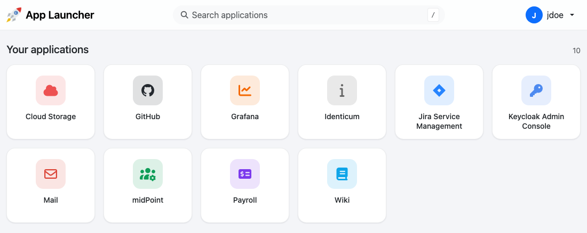

# launcher

A web page that shows each user the applications they can use, based on their roles.



- **Launcher page**: one tile per application the user can access, with instant search (press `/`, type, Enter opens the first match) and a light or dark theme.
- **Administration page**: add, edit and delete links, choose icons from the bundled Font Awesome set, and decide which roles can see each link.
- **Import and export** of all links as JSON, compatible with the files of the previous (Java) version.
- **Databases**: SQLite (default), PostgreSQL, Oracle 18 or later, and MySQL/MariaDB.
- **Works offline**: every library, font and icon is served by the launcher itself.

The launcher does not authenticate users itself. It runs behind [IPAx](https://github.com/identicum/ipax), which signs the user in with OpenID Connect and tells the launcher who they are.

## How it works

```
browser ──> IPAx ──────────────────────────────> launcher ──> database
            signs the user in (OIDC) and adds:
              IPAx-USERNAME: jdoe
              IPAx-ROLES:    App01|App02|Launcher_Administrators
```

- A user sees a link when one of their roles in `IPAx-ROLES` is one of the link's roles. Matching is case-sensitive.
- Links with the role `PUBLIC` are shown to every signed-in user, including users with no roles.
- Users with the role in `ADMIN_ROLE` also get the administration page.
- Requests without `IPAx-USERNAME` are rejected.

> [!IMPORTANT]
> Only IPAx may be able to reach the launcher. Anyone who can send requests to it directly can set the `IPAx-*` headers and act as any user. Don't publish the launcher's port; put it on a network only IPAx can reach.

## Quick start

The launcher is distributed as a container image:

```sh
docker run -d --name launcher \
  -e ADMIN_ROLE=Launcher_Administrators \
  -v launcher-data:/data \
  ghcr.io/identicum/launcher:latest
```

This stores the links in SQLite, in the `/data` volume. Then point IPAx at `http://launcher:8080` (see [IPAx configuration](#ipax-configuration)).

To try the whole setup (Keycloak, IPAx and the launcher) on your computer, see [Local environment](#local-environment).

## Configuration

All settings are environment variables.

| Variable | Default | Description |
|---|---|---|
| `ADMIN_ROLE` | *(required)* | Role, as sent in `IPAx-ROLES`, that grants access to the administration page. The launcher doesn't start without it. |
| `PUBLIC_ROLE` | `PUBLIC` | Role name that makes a link visible to every signed-in user. |
| `DB_TYPE` | `sqlite` | `sqlite`, `postgresql`, `oracle` or `mysql` (also for MariaDB). |
| `DB_HOST` | | Database host. Required unless `DB_TYPE=sqlite`. |
| `DB_PORT` | `5432` / `1521` / `3306` | Database port. The default depends on `DB_TYPE`. |
| `DB_NAME` | `/data/launcher.db` for SQLite | Database name. For Oracle, the **service name** (e.g. `FREEPDB1`). For SQLite, the file path. |
| `DB_USER` | | Database user. Required unless `DB_TYPE=sqlite`. |
| `DB_PASSWORD` | | Database password. No escaping needed. |
| `DB_URL` | | A full [SQLAlchemy URL](https://docs.sqlalchemy.org/en/20/core/engines.html#database-urls). When set, it replaces all the `DB_*` variables above. Drivers: `postgresql+psycopg`, `oracle+oracledb`, `mysql+pymysql`, `sqlite`. |
| `DB_AUTO_CREATE` | `true` | Create the `link` and `role` tables if they don't exist. Set it to `false` when a DBA creates them (see [Databases](#databases)). |
| `DATA_DIR` | `/data` | Folder for the SQLite file and the initial data file. |
| `INITIAL_DATA_FILE` | `$DATA_DIR/data.json` | JSON file imported when the database has no links. Same format as an export. |
| `LOGOUT_URL` | `/private/logout` | Where the **Log out** menu item goes. The default is IPAx's logout path. |
| `APP_TITLE` | `App Launcher` | Name shown in the page header and the browser tab. |
| `STYLE_BACKGROUND` | | CSS [`background`](https://developer.mozilla.org/en-US/docs/Web/CSS/background) of the pages, for example `#e9eef5` or `linear-gradient(#e9eef5, #ffffff)`. An image from another site (`url(https://...)`) won't load on networks without internet access. |
| `STYLE_BACKGROUND_SIZE` | | CSS `background-size`, for example `cover`. |
| `LOG_LEVEL` | `INFO` | `DEBUG`, `INFO`, `WARNING` or `ERROR`. |
| `PORT` | `8080` | Port the launcher listens on. |
| `FORWARDED_ALLOW_IPS` | `*` | Proxies whose `X-Forwarded-*` headers are trusted, so links and redirects use the external scheme. |

## Databases

On startup the launcher creates its two tables if they're missing (`link` and `role`). It never changes existing tables, so it can use a database created by the Java version as is.

| Database | Example settings | Notes |
|---|---|---|
| SQLite | *(none)* | Stored in `/data/launcher.db`. Keep `/data` on a volume. Fine for a single instance. |
| PostgreSQL | `DB_TYPE=postgresql` `DB_HOST=db` `DB_NAME=launcherdb` `DB_USER=launcherusr` `DB_PASSWORD=...` | |
| Oracle 18+ | `DB_TYPE=oracle` `DB_HOST=oracle` `DB_NAME=FREEPDB1` `DB_USER=launcherusr` `DB_PASSWORD=...` | `DB_NAME` is the service name. No Oracle client needed. |
| MySQL / MariaDB | `DB_TYPE=mysql` `DB_HOST=mysql` `DB_NAME=launcherdb` `DB_USER=launcherusr` `DB_PASSWORD=...` | Use a `utf8mb4` database. |

If the database user can't create tables, ask your DBA to run the statements printed by the `ddl` command, and set `DB_AUTO_CREATE=false`:

```sh
docker run --rm ghcr.io/identicum/launcher:latest ddl oracle   # or postgresql, mysql, sqlite
```

The user then needs `SELECT`, `INSERT`, `UPDATE` and `DELETE` on both tables.

## IPAx configuration

Run IPAx in proxy mode with a `server` block like this one. It signs the user in, and forwards the user name and the names of the user's groups to the launcher:

```nginx
server {
	server_name launcher.example.com;
	include /var/ipax/conf/location_norobots.conf;
	include /var/ipax/conf/location_logoutSuccess.conf;
	set $oidc_redirect_uri 'https://launcher.example.com/private/redirect_uri';
	set $oidc_post_logout_redirect_uri 'https://launcher.example.com/logoutSuccess.html';

	location / {
		access_by_lua_block {
			local ipax = require "ipax"
			local oidc_opts = ipax.get_oidc_opts()
			local session_opts = ipax.get_session_opts()
			ngx.ctx.res = ipax.get_res(oidc_opts, session_opts)
			ipax.filter_session_cookies(session_opts)
			local user = ipax.get_user(ngx.ctx.res)
			ngx.req.set_header("IPAx-USERNAME", user.preferred_username)
			-- member_of holds group DNs; send only the group names (CN), separated by "|"
			ngx.req.set_header("IPAx-ROLES", ipax.get_ldap_object_names(user.member_of, "|"))
		}
		proxy_pass http://launcher:8080;
		proxy_set_header Host $host;
		proxy_set_header X-Forwarded-Proto $scheme;
		proxy_set_header X-Forwarded-For $proxy_add_x_forwarded_for;
	}
}
```

- The roles come from whatever claim you pass in `IPAx-ROLES`. In this example it's `member_of`, with LDAP group DNs such as `CN=App01,OU=groups,DC=example,DC=com`, which IPAx turns into `App01`. The role names you give links in the launcher must be these names.
- The launcher must be served at the root path (`/`) of its host name.
- Always set both headers in IPAx, so a value sent by the browser is replaced. [localhost/ipax/launcher.conf](localhost/ipax/launcher.conf) is a complete example.

## Import and export

On the administration page, **Export** downloads every link as `launcher-YYYYMMDD.json`, and **Import** loads such a file. The format is the same as in the Java version:

```json
{
  "links": [
    {
      "id": 2,
      "icon": "fa-solid fa-cloud",
      "color": "#ED5151",
      "target": "https://app01.example.com/",
      "type": "html",
      "display": "App01",
      "roles": [{ "id": 3, "name": "App01" }]
    }
  ]
}
```

- `display` and `target` are required. `id` values are written on export and ignored on import.
- `icon` takes [Font Awesome 7 free](https://fontawesome.com/search?ic=free) classes. Older names such as `fas fa-info` or `fas fa-shield-alt` still work.
- Role names written as LDAP DNs (`CN=App01,OU=...`) are converted to the plain name (`App01`), the same way IPAx builds `IPAx-ROLES`.
- Links are matched by `target`. The import **mode** decides what happens when a link with the same target already exists:

| Mode | Existing link with the same target | Other existing links |
|---|---|---|
| `skip` (default) | Kept as it is | Kept |
| `update` | Overwritten with the file's values and roles | Kept |
| `replace` | — | All deleted before importing |

The whole file is checked first: if any link is invalid, nothing is imported and every problem is listed.

For scripts and backups, use the command line inside the container:

```sh
docker exec launcher launcher export /data/backup.json
docker exec launcher launcher import /data/backup.json --mode update
```

The page uses the endpoints `GET /admin/data/export` and `POST /admin/data/import` (multipart field `importFile`, plus `mode`), the same URLs as in the Java version.

## Migrating from the Java version

The new launcher uses the same tables and the same JSON format, so you can migrate either way below. In both cases:

- Remove the launcher's own OIDC client from the IdP. IPAx has its own.
- Set `ADMIN_ROLE` to the group name that matched `app.roles.admin` before (for example `Launcher_Administrators`).
- The old `application.properties` settings for OIDC (`security.oauth2.*`, `idp.*`, `app.roles.*`, `app.post_logout_uri`) are no longer used.

**Option 1: keep the same database.** Point the new image at the database the Java version used (`DB_TYPE`, `DB_HOST`, ...), then convert the role names from DNs to the names IPAx sends:

```sh
docker exec launcher launcher normalize-roles --dry-run   # shows what would change
docker exec launcher launcher normalize-roles
```

**Option 2: export and import.** Export the links from the Java version (**Export data** in its menu), start the new launcher on any database, and import the file. DN role names are converted during the import.

## Local environment

[localhost/](localhost/) starts PostgreSQL, Keycloak, IPAx and the launcher (built from this repository) with sample links and two users.

1. Add `127.0.0.1 idp` to `/etc/hosts`. The browser and IPAx must both reach Keycloak at `idp:8080`.
2. Start it:

   ```sh
   cd localhost
   docker compose up -d --build
   ```

3. Open http://localhost and log in as:
   - `demo` / `demo`: administrator (`Launcher_Administrators`, `App01`).
   - `user` / `user`: regular user (`App02`).

To run the launcher on Oracle or MySQL instead of PostgreSQL, add the override file. Run `docker compose down` first when switching:

```sh
docker compose -f compose.yaml -f compose.oracle.yaml up -d --build
docker compose -f compose.yaml -f compose.mysql.yaml up -d --build
```

## Development

The launcher is a Python application (FastAPI, SQLAlchemy and Jinja2). The pages use Bootstrap and Font Awesome, bundled in [launcher/static/vendor/](launcher/static/vendor/).

```sh
python3 -m venv .venv
.venv/bin/pip install -e '.[test]'

# run it (SQLite in ./data), then send the IPAx headers yourself, e.g. with a browser extension
DATA_DIR=./data ADMIN_ROLE=Launcher_Administrators .venv/bin/launcher serve

# tests on SQLite
.venv/bin/pytest

# tests on another database, started in a throwaway container
PYTEST=.venv/bin/pytest scripts/test-db.sh postgresql   # or oracle, mysql, mariadb
```

To upgrade Bootstrap or Font Awesome, change the versions in [scripts/update_vendor.py](scripts/update_vendor.py), run it with `python3 scripts/update_vendor.py`, and commit the result.

On every push to `main`, the [build workflow](.github/workflows/build.yml) runs the tests on every database and a CodeQL analysis, then publishes `ghcr.io/identicum/launcher` with the tags `latest` and the build date (`YYYYMMDD`). It also rebuilds the image once a month to pick up base image updates.
